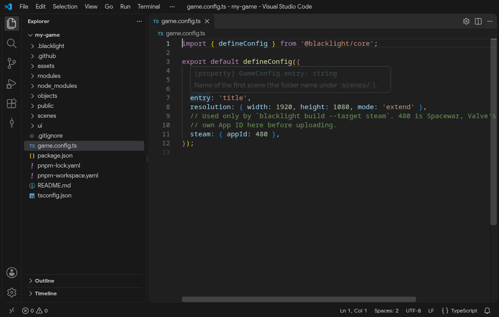
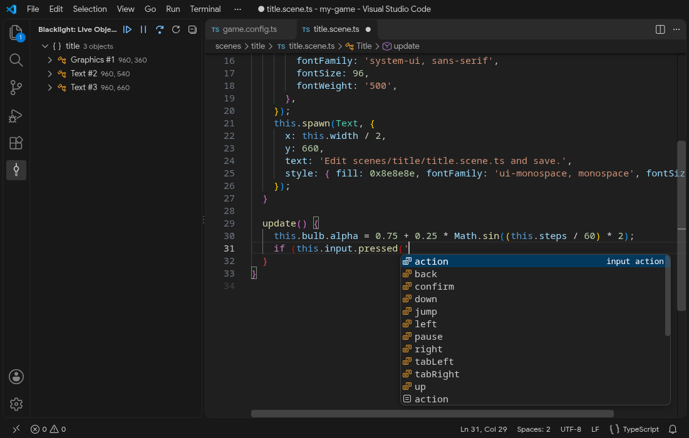
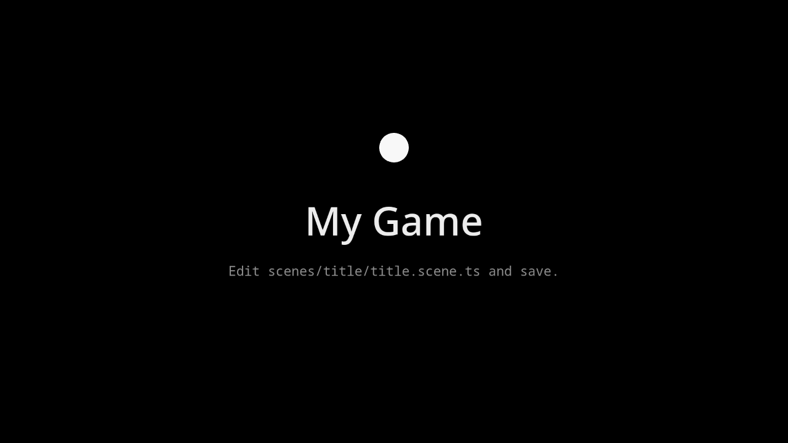
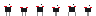
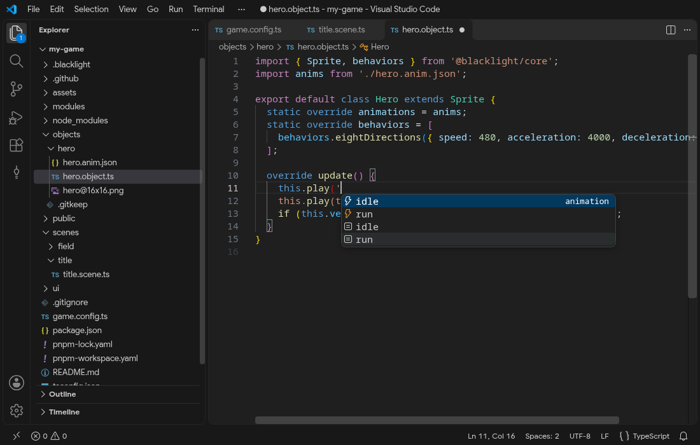
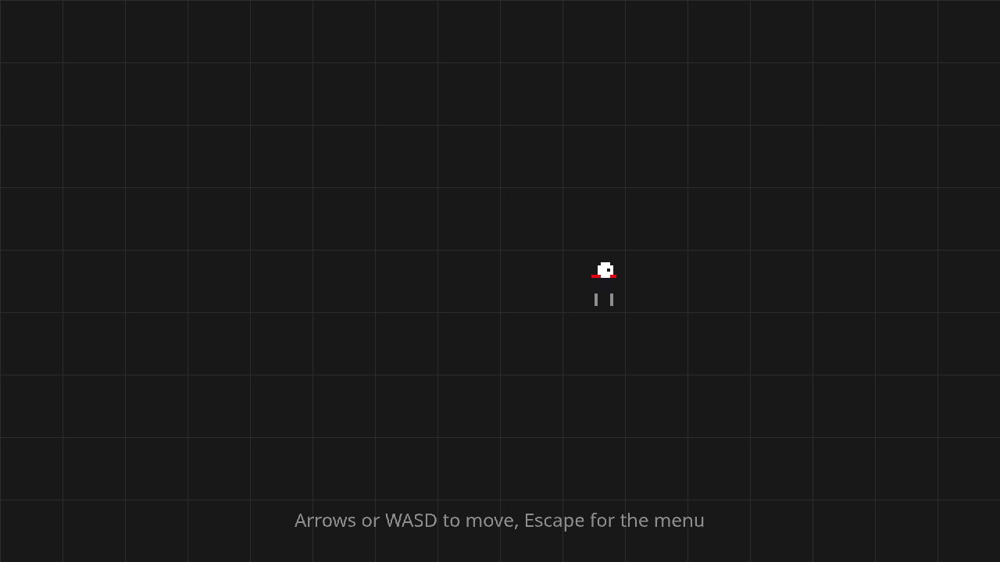
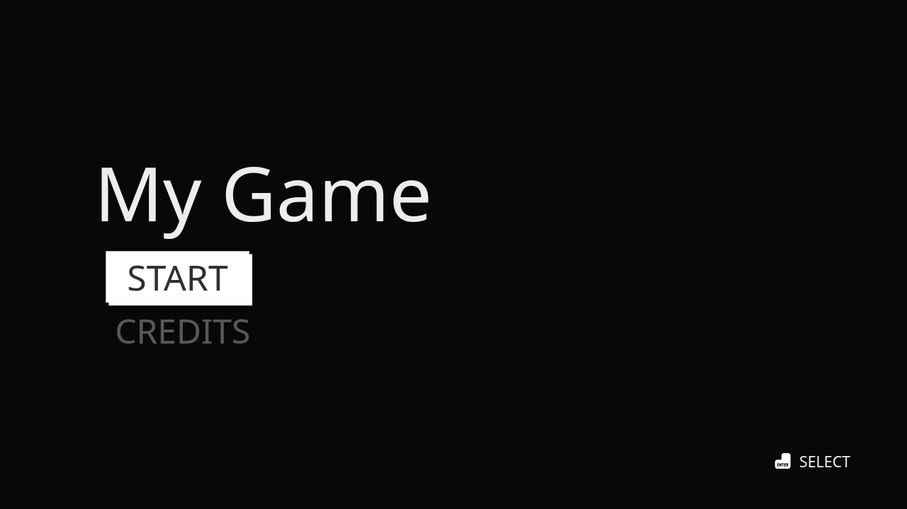
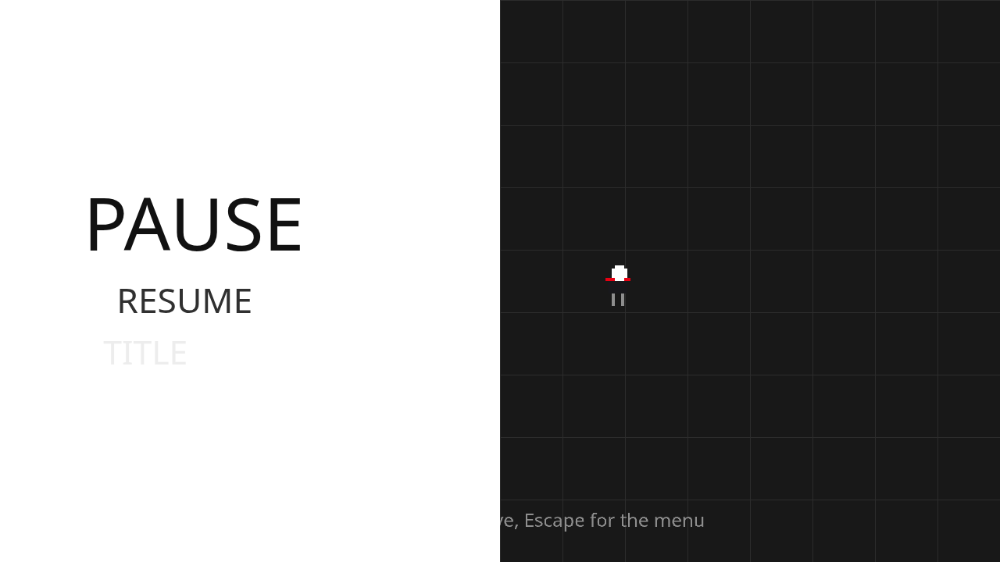

# Getting started

This guide goes from an empty folder to a small game: a title menu, a field where an animated character runs where you steer it, and a pause menu over the field. It takes well under an hour, most of it reading. Every file below is shown in full, and the finished project is the one the test suite builds and plays on every change (`e2e/getting-started.spec.ts`), so the code on this page runs as written.

You need Node.js 24 or newer, [pnpm](https://pnpm.io/installation) 12 or newer and, for the pictures below, VS Code with the Blacklight Engine extension: [Install the tools](./installation) sets them up. Any editor works; the extension adds completion for animation names, actions and asset paths. The pictures and terminal output on this page are taken from a real run of these steps by the test suite (`e2e/guide-captures.spec.ts`).

## 1. Create the project

In a terminal, in the folder that will hold the project:

<<< @/guide/captures/create.txt{console}

`pnpm dlx` downloads `create-blacklight` from the latest [GitHub release](https://github.com/beedywool/blacklight-engine/releases) of the engine and runs it once, without installing anything globally. The new project's `package.json` points every engine package at the tarballs of that same release (`"@blacklight/core": "https://github.com/beedywool/blacklight-engine/releases/download/v1.2.0/blacklight-core-1.2.0.tgz"`), so the engine comes from GitHub and every other dependency from npm. `--engine-version 1.1.0` targets another release, and `pnpm blacklight upgrade` later moves the project to a newer one ([Command line tools](./tooling#upgrade)). `my-game` is the folder to create; without it, the command asks. `--template <name>` starts from another template ([Start from a template](./templates) runs through all six: a platformer, a Persona-style menu, a visual novel, 2D with 3D models and a party game); `--help` lists them. Then install the engine packages:

```sh
cd my-game
pnpm install
```

```
my-game/
├── game.config.ts               name, id, version, entry scene, resolution
├── scenes/title/title.scene.ts  the first scene
├── objects/  ui/  modules/  assets/  public/
├── package.json                 dev, build, preview, typecheck
└── tsconfig.json
```

The `.blacklight/` folder holds files the CLI generates on each run (entry page, typed names). It is ignored by git; do not edit it.

### Open it in VS Code

Open the folder in VS Code (**File > Open Folder…**, or `code .` in the terminal). The extension finds `game.config.ts` and activates: the Blacklight icon appears in the activity bar on the left. `game.config.ts` is typed, so hovering a field shows what it does and completion lists the fields you can add:



The Blacklight icon opens the **Live Objects** view: while the dev server runs and the game is open in a browser (next step), it lists the objects of the running scene with their positions, and you can pause the game, step it and edit variables ([Live objects and variables](./vscode#live-objects-and-variables)). In code, the extension completes the names the engine reads as strings. Here, in `scenes/title/title.scene.ts`, the actions a key can trigger:



### Run it

<<< @/guide/captures/dev.txt{console}

Open `http://localhost:5173`: the title scene of the `empty` template.



Leave the dev server running: every file you save from now on reloads the page, and an error shows up on the page with the file and the fix instead of a blank screen. `pnpm dev --host` also listens on the network, so a phone on the same Wi-Fi can open the game. If port 5173 is taken, the server picks the next free one and prints it.

## 2. Add the UI layer

Menus are Vue components drawn over the game canvas. They come with `@blacklight/ui`, which `blacklight add` installs from the same release as the rest of the engine, and Vue:

```sh
pnpm blacklight add @blacklight/ui
pnpm add vue
```

The CLI notices the package and installs the UI layer when the game starts: `.vue` files in `ui/` become screens, opened by their file name.

## 3. Configure the game

Replace `game.config.ts`:

<<< @/examples/getting-started/game.config.ts

`entry` is the scene the game starts with. The resolution is virtual: you place everything on a 1920 × 1080 area, and the engine scales it to the window. With `extend`, a wider or taller window shows more of the background instead of black bars. `pixelArt` turns off smoothing, so small sprites stay sharp when scaled up. Every field is checked when the game starts; [Configuration](./configuration) lists them all.

## 4. The hero

A game object lives in its own folder under `objects/`. Create `objects/hero/` and save this sprite sheet in it as `hero@16x16.png` (<a href="/downloads/hero@16x16.png" download>download</a>):

{style="image-rendering: pixelated; width: 384px"}

The `@16x16` in the name tells the engine to cut the image into 16 × 16 frames, numbered from 0, left to right. Frames 0 and 1 are the idle pose, 2 to 5 the run cycle. The animation file names them, next to the sheet as `objects/hero/hero.anim.json`:

<<< @/examples/getting-started/objects/hero/hero.anim.json

The `$schema` line gives completion and checks in VS Code. Then the object itself, `objects/hero/hero.object.ts`:

<<< @/examples/getting-started/objects/hero/hero.object.ts

As soon as `hero.anim.json` is saved, the extension knows its animations: `this.play('` completes them.



`Hero` is a `Sprite`: an object drawn from a sheet. `static animations` attaches the animation file, `static behaviors` the ready-made [eightDirections](../behaviors/eight-directions) movement: the arrows, WASD, the D-pad and the left stick move it, with a short acceleration and deceleration. `update()` runs 60 times per second whatever the screen's refresh rate; it plays `run` while the hero moves and `idle` otherwise, and mirrors the sprite when it goes left. `play` does nothing when the animation already plays, so calling it every step is the normal way.

## 5. The field

A scene is a folder under `scenes/` with a `<name>.scene.ts` file. Create `scenes/field/field.scene.ts`:

<<< @/examples/getting-started/scenes/field/field.scene.ts

`create()` runs once when the scene starts. `spawn` creates an object in the scene and sets its properties; `Graphics` and `Text` are ready-made objects. `@objects/hero/hero.object` is an alias of `objects/hero/hero.object.ts`. In `update()`, `this.input.pressed('pause')` is true on the step where Escape (or Start on a gamepad) goes down; `pause` is one of the default actions, along with `left`, `right`, `up`, `down`, `confirm` and `back` ([Input](./input)).



`this.ui.push('PauseMenu')` opens the screen `ui/PauseMenu.vue` on top of the others. A pushed screen takes the keyboard and gamepad until it closes: the scene keeps running, but game input reads as idle, so the hero stops without any check in its code. `this.game.pause()` would also freeze the scene.

## 6. The title menu

Replace `scenes/title/title.scene.ts` with a scene that opens a menu:

<<< @/examples/getting-started/scenes/title/title.scene.ts

and create the menu, `ui/TitleMenu.vue`:

<<< @/examples/getting-started/ui/TitleMenu.vue

`MenuList` draws the rows and handles focus: up and down move between them (mouse and touch work too), confirm (Enter, Space, the A button) emits `select` with the row's `value`. Disabled rows are skipped. `InputPrompt` shows the key or button of an action for the device the player last used. `useGame()` gives the running game, and `game.goto('field', …)` switches scene with a transition. Units in the styles are virtual pixels, like everything else: `72px` is 72 pixels of the 1920 × 1080 area.

The page now shows the menu. Press Enter: the field fades in, and the hero runs where you steer it.



## 7. The pause menu

Create `ui/PauseMenu.vue`:

<<< @/examples/getting-started/ui/PauseMenu.vue

`useScreen` gives the screen's own controls: its enter and leave [transitions](./ui-transitions) and `close()`. Escape (or B on a gamepad) also closes it, because `back` closes a pushed screen by default. `TITLE` goes back to the title scene with an iris.

Press Escape in the field: the red panel slashes in over the field. That is the whole game.



## 8. Check and build

```sh
pnpm typecheck    # generates the typed names, then runs tsc
pnpm build        # blacklight build --target web → dist/
pnpm preview      # serves dist/ on http://localhost:4173
```

`typecheck` checks the `.ts` files. To check the `<script setup>` blocks of `.vue` files too, add `vue-tsc` (`pnpm add -D vue-tsc`) and replace `tsc` with `vue-tsc` in the `typecheck` script of `package.json`.

The web build uses relative URLs, so `dist/` works from any path on a web server. Desktop, mobile and Steam builds use the same project without changes: `blacklight build --target <web|win|mac|linux|android|ios|steam>` ([Command line tools](./tooling)).

## Next

- [Concepts](./concepts): how scenes, objects, behaviors, the fixed step and the UI layer fit together.
- [Sprites and animations](./sprites-and-animations): Aseprite sheets, frame events, hitboxes, directional animations.
- [Behaviors](./behaviors): platformer, grid movement, pointer drag and the 16 others, each with a live example.
- [UI layer](./ui) and [Widgets](./ui-widgets): screens, focus, sliders, tabs, gauges.
- [Tutorials](../tutorials/): short explanations followed by exercises to do in the page, from scenes to transitions.
- The [playground](/playground): a project like this one, editable in the browser.

## Limits

- The guide uses the `empty` template. `pnpm dlx https://github.com/beedywool/blacklight-engine/releases/latest/download/create-blacklight.tgz my-game --template persona-menu` starts from a complete Persona-style menu instead; [Start from a template](./templates) covers the other five.
- `pnpm dlx` keeps a downloaded package for a day. Within a day of a new release, the `latest` URL can still run the previous scaffolder, which creates a project on the previous engine; the URL of a given release always runs that one: `pnpm dlx https://github.com/beedywool/blacklight-engine/releases/download/v1.2.0/create-blacklight-1.2.0.tgz my-game`.
- The engine has no visual editor for game logic: objects are placed by code here. The [VS Code extension](./vscode) has a scene editor that saves placements as JSON for `scene.load`.
- Sound is not covered here: see [Audio](./audio).
