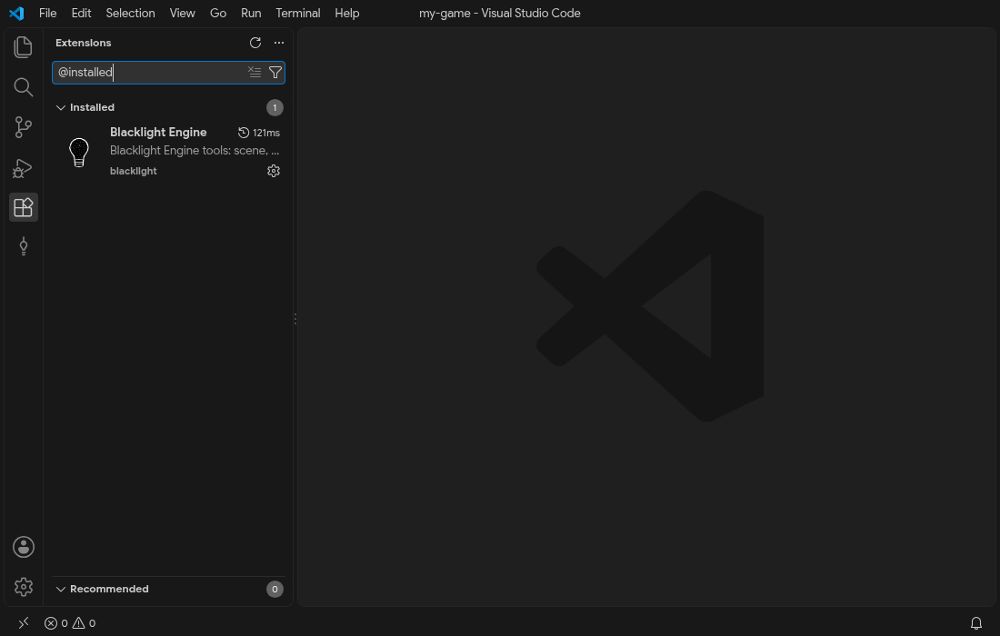

# Install the tools

A Blacklight game is a Node.js project: you write TypeScript, the `blacklight` command line tool serves it to a browser while you work and builds it for the web, desktop and phones. This page installs what that needs, once per machine. [Getting started](./getting-started) then creates a game with it.

| Tool                        | Version            | Used for                                            |
| --------------------------- | ------------------ | --------------------------------------------------- |
| Node.js                     | 24 or newer        | Runs the CLI, the dev server and the builds         |
| pnpm                        | 12 or newer        | Creates projects and installs the engine packages   |
| VS Code                     | 1.125 or newer     | Editor; any editor works, VS Code has the extension |
| Blacklight Engine extension | same as the engine | Completion of names, editors, live debugging        |

## Node.js

Install the current LTS release from [nodejs.org](https://nodejs.org/en/download), with your system's package manager, or with a version manager such as `fnm` or `nvm`. Then check it in a new terminal:

```sh
node --version   # v24.x or newer
```

## pnpm

Install pnpm with one of the methods of [pnpm.io/installation](https://pnpm.io/installation) (the standalone script, Homebrew, winget or `npm install -g pnpm`), then check it:

```sh
pnpm --version   # 12.x or newer
```

Projects created by `pnpm create blacklight` pin the pnpm version in `package.json` (`packageManager`), so every machine of a team installs the same dependency tree.

## VS Code

Install VS Code from [code.visualstudio.com](https://code.visualstudio.com/). The engine does not depend on it: a game is plain TypeScript, JSON and Vue files, and `pnpm typecheck` reports the same errors in any editor. VS Code adds the extension below and the TypeScript completion every page of this guide relies on.

## The Blacklight Engine extension

In VS Code, open the Extensions view (`Ctrl+Shift+X`, `Cmd+Shift+X` on macOS), search for "Blacklight Engine" and install it. VSCodium and other editors built on VS Code install it from Open VSX under the same name.

To use the extension of a local checkout of the engine instead (to try a change, or before a release is published), build the package and install the file:

```sh
pnpm --filter blacklight-vscode build
pnpm --filter blacklight-vscode package   # writes packages/vscode/dist/blacklight.vsix
code --install-extension packages/vscode/dist/blacklight.vsix
```

The installed extension shows in the Extensions view; `@installed` in the search box lists only what is installed:



The extension stays idle until you open a folder with a `game.config.ts`. It then adds the Blacklight icon (a hanging bulb) to the activity bar on the left, completion for animation, action, scene, object and screen names, and the editors listed in [VS Code extension](./vscode).

## Next

[Getting started](./getting-started) creates a project, opens it in VS Code and builds a small game in eight steps.

## Limits

- The pictures on this page and in Getting started are taken on Linux by `pnpm docs:screenshots` (see `e2e/guide-captures.spec.ts`): VS Code downloaded by `@vscode/test-electron`, the extension packaged from this repository and installed from its `.vsix`, the Default Dark Modern theme. On macOS the shortcuts use `Cmd` instead of `Ctrl`; the rest looks the same.
- The engine is tested on Node.js 24, the version the repository requires (`engines` in its `package.json`). Older versions are not tested and the CLI does not check the version it runs on.
